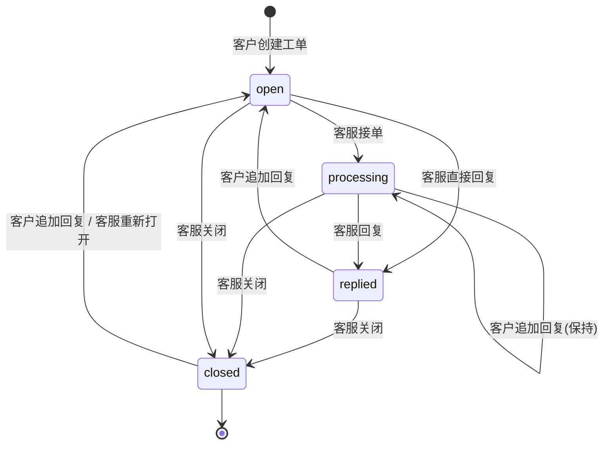

# 工单系统 · Ticket System

一个自托管、轻量的 **Web 工单 / 客服系统**。固定技术栈 **PHP 8.0+ / MySQL / 原生 CSS·JS**，**不使用任何 PHP 框架与前端框架，不依赖任何 CDN 与外部库**，开箱即用、易于二次开发。

| 项目 | 信息 |
|---|---|
| 开发公司 | 辞云网络科技有限公司 |
| 公司官网 | [ciyunc.cn](https://ciyunc.cn) |
| 作者 | Ethan（退后无解） |
| 许可证 | MIT License |

本文档合并在同一份文件中，包含四部分：

- **一、功能文档**
- **二、部署文档**
- **三、AI 对接文档**
- **四、QQ 机器人对接文档**

---

## 特性速览

- 客户提交工单、追加回复、查看进度；**强制邮箱验证**后才可使用业务功能
- 客服工作台：仪表盘、工单列表（按状态筛选 / 搜索）、接单、回复、关闭、重新打开
- 组织管理：用户（客户）管理、客服管理
- 多渠道通知：**邮件**（内置 SMTP 客户端）+ **QQ 机器人**（可选）+ **站内通知**
- **AI 客服**：一键让 AI 生成回复建议（人工确认后发送），可选「新工单自动回复」
- 深色科技风 UI、玻璃拟态、完全响应式（桌面 / 平板 / 手机）
- 图形化安装向导，含环境检测；老版本数据库自动升级（幂等迁移）
- 安全实践：PDO 预处理、`htmlspecialchars` 输出转义、`password_hash/verify`、CSRF 令牌、Session 会话

---

# 一、功能文档

## 1.1 角色与权限

系统内置两种角色（`users.role`）：

| 角色 | 说明 | 可用范围 |
|---|---|---|
| `customer` 客户 | 终端用户 | 注册、登录、验证邮箱、创建/查看/回复**自己**的工单、绑定 QQ 通知 |
| `agent` 客服/管理员 | 后台人员 | 仪表盘、全部工单管理、用户/客服管理、系统设置 |

> 说明：本版本未单独区分「超级管理员」与「普通客服」，所有 `agent` 账号均可访问后台管理页。如需更细粒度的权限，可在此基础上扩展。

**强制业务规则**

- 客户注册后必须完成**邮箱验证**（6 位验证码，30 分钟有效），否则访问工单页会被拦截到验证页。
- 客服账号不强制邮箱验证。
- QQ 机器人通知为**可选**：客户不绑定也能正常使用系统。

## 1.2 工单状态流转



| 状态 | 含义 | 触发 |
|---|---|---|
| `open` 待处理 | 待受理 | 新建工单；客户在被回复/关闭后追加回复会自动回到此状态 |
| `processing` 处理中 | 客服已接单 | 客服点「接单处理」 |
| `replied` 已回复 | 客服已答复 | 客服回复或点「标记已回复」 |
| `closed` 已关闭 | 已完结 | 客服点「关闭工单」 |

## 1.3 通知矩阵

| 事件 | 触发点 | 通知客户 | 通知管理员/客服 |
|---|---|---|---|
| `created` | 客户创建工单 | ✅ 提交确认 | ✅ 新工单提醒 |
| `processing` | 客服接单 | ✅ | ✅ |
| `replied` / `agent_reply` | 客服回复 | ✅ | ✅ |
| `closed` | 客服关闭 | ✅ | ✅ |
| `customer_reply` | 客户追加回复 | ✅ | ✅ |

- **邮件渠道**：客户邮件发送到工单所属客户邮箱；管理员邮件发送到「管理员通知邮箱」（支持多个，逗号分隔）。邮件服务未配置时自动跳过，不影响业务。
- **QQ 渠道**：仅当客户已绑定机器人时发送，遵循配额与被动回复策略（见第四部分）。
- **站内渠道**：始终写入 `notifications` 表，后台顶部铃铛显示未读数，作为兜底。

## 1.4 页面与功能清单

**客户侧**（品牌头布局）

- `index.php` 首页落地页：未登录引导登录/注册，已登录按角色跳转
- `register.php` 注册（创建后自动发验证码）
- `verify_email.php` 邮箱验证（输入验证码 / 重新发送）
- `login.php` / `logout.php` 登录 / 登出
- `ticket_create.php` 创建工单（标题、描述、优先级 低/中/高）
- `ticket_list.php` 我的工单列表
- `ticket_detail.php` 工单详情 + 回复时间线 + 追加回复
- `bind_guide.php` QQ 通知绑定引导（可选）；`check_binding.php` 绑定状态轮询接口

**后台**（侧边栏布局）

- `agent_dashboard.php` 仪表盘：工单统计、未读通知
- `agent_tickets.php` 全部工单（按状态筛选、关键词搜索）
- `agent_ticket_detail.php` 工单详情：接单 / 回复 / 关闭 / 重新打开 / **AI 生成回复**
- `admin_users.php` 用户管理 / 客服管理
- `admin_settings.php` 系统设置：QQ 机器人、邮件服务、站点信息、通知策略、**AI 客服**

**回调与接口**

- `callback.php` / `qq_webhook.php` QQ 机器人事件回调入口
- `ai_reply.php` 客服端「AI 生成回复」JSON 接口

## 1.5 数据库结构（`install.sql`）

| 表 | 用途 |
|---|---|
| `users` | 账号（含邮箱验证字段 `email_verified_at` / `verify_code` / `verify_expires`） |
| `tickets` | 工单（状态、优先级、指派的客服） |
| `ticket_replies` | 回复时间线（`reply_type`: customer / agent / system / ai） |
| `qq_bindings` | QQ 绑定关系、主动消息计数、最近消息 id |
| `notifications` | 站内通知 |
| `settings` | 键值配置（含 `schema_version`） |

---

# 二、部署文档

## 2.1 环境要求

| 项目 | 要求 |
|---|---|
| PHP | **8.0+** |
| PHP 扩展 | `pdo_mysql`、`curl`；`sodium` **或** `openssl`（≥1.1.1，用于 QQ 回调签名） |
| 数据库 | MySQL 5.7+ / MariaDB 10.3+（utf8mb4） |
| Web 服务器 | Nginx / Apache / 宝塔面板等 |
| 其他 | 需 HTTPS（QQ 机器人回调强制 HTTPS） |

> 不装 `sodium` 也可以：系统会自动回退到 `openssl` 完成 Ed25519 签名。

## 2.2 部署步骤

1. **上传代码**：将本项目全部文件放到站点根目录（如 `/www/wwwroot/ticket`）。
2. **设置权限**：确保 Web 用户对项目根目录**可写**（安装需写入 `config.php`），并允许创建 `runtime/` 目录：

   ```bash
   chown -R www:www /www/wwwroot/ticket
   chmod -R 755 /www/wwwroot/ticket
   ```

3. **绑定域名**：将域名解析并指向该目录，配置好 **HTTPS 证书**。
4. **运行安装向导**：浏览器访问 `https://你的域名/install.php`，按 4 步完成：
   - ① 环境检测（PHP 版本 / PDO / cURL / 目录写权限 / 签名能力）
   - ② 数据库配置（自动建库、执行 `install.sql`、生成 `config.php`）
   - ③ 创建管理员账户（可同时填 QQ 机器人 AppID / AppSecret，也可稍后再填）
   - ④ 完成（生成 `install.lock`）
5. **收尾（建议）**：安装完成后**删除 `install.php`**，或保留 `install.lock` 以阻止重复安装。
6. **配置邮件**：登录后台 →「系统设置 → 邮件服务」填 SMTP，点「测试发信」验证；在「管理员通知邮箱」填入你自己的邮箱以接收工单提醒。

## 2.3 Web 服务器配置参考

**Nginx**（务必原样透传请求体，否则 QQ 回调签名校验会失败）：

```nginx
server {
    listen 443 ssl http2;
    server_name ticket.example.com;

    ssl_certificate     /path/to/fullchain.pem;
    ssl_certificate_key /path/to/privkey.pem;

    root /www/wwwroot/ticket;
    index index.php;

    location / {
        try_files $uri $uri/ /index.php?$query_string;
    }

    location ~ \.php$ {
        include        fastcgi_params;
        fastcgi_param  SCRIPT_FILENAME $document_root$fastcgi_script_name;
        fastcgi_pass   unix:/run/php/php8.1-fpm.sock;   # 按实际 PHP-FPM 调整
        fastcgi_request_buffering on;
    }

    # 保护运行期与配置文件
    location ~ ^/(config\.php|install\.lock)$ { deny all; }
    location ~ ^/runtime/ { deny all; }
}
```

**Apache**（`.htaccess` 示例）：

```apache
<IfModule mod_rewrite.c>
    RewriteEngine On
    RewriteCond %{REQUEST_FILENAME} !-f
    RewriteCond %{REQUEST_FILENAME} !-d
    RewriteRule ^ index.php [L]
</IfModule>
<FilesMatch "^(config\.php|install\.lock)$">
    Require all denied
</FilesMatch>
```

## 2.4 升级 / 迁移 / 备份

- **升级**：覆盖新版本代码即可（**不要覆盖** `config.php`）。首次访问会自动执行幂等迁移（`schema_version`），无需手动改表。
- **备份**：数据库用 `mysqldump`，文件侧备份 `config.php` 与 `runtime/`。
- **迁移**：整目录 + 数据库一并搬迁，改好域名后更新「系统设置 → 站点根地址」。

## 2.5 常见问题（部署）

| 现象 | 排查方向 |
|---|---|
| 访问首页 403 | Web 服务器未默认加载 `index.php`，或目录无索引权限；确认 `index index.php;` 且根目录指向正确 |
| 提示未安装 / 跳转 install | 根目录没有 `config.php`；重新运行 `install.php` |
| 安装写 config.php 失败 | 目录不可写，检查属主与权限 |
| 邮件发不出 | 核对服务器/端口/加密方式；国内邮箱需用**授权码**而非登录密码；发件邮箱需与 SMTP 账号一致 |
| 页面样式丢失 | 未正确部署 `assets/` 目录 |
| QQ 回调「签名校验不通过」 | 见第四部分排查清单 |

---

# 三、AI 对接文档

AI 能力为**可选**功能，走 **OpenAI 兼容协议**（`POST {base_url}/chat/completions`），可通过 cURL 对接任意兼容服务。

## 3.1 配置位置

后台 →「系统设置 → **AI 客服设置**」。配置项：

| 配置项 | 说明 | 示例 |
|---|---|---|
| 启用 AI | 总开关 | 开 |
| AI 接口地址（Base URL） | 不含 `/chat/completions`，系统自动拼接 | `https://api.deepseek.com/v1` |
| API Key | 服务商密钥 | `sk-xxxx` |
| 模型 | 模型名 | `deepseek-chat` |
| 温度（0~2） | 越高越发散，客服场景建议 0.2~0.5 | `0.3` |
| 最大输出长度 | `max_tokens` | `800` |
| AI 自动回复 | 开：新工单立即由 AI 回复；关：仅提供人工「AI 生成回复」 | 关 |
| AI 回复署名 | 自动回复时追加在正文末尾 | `AI 客服助手` |
| AI 系统提示词 | 「训导」AI 的核心，决定角色/语气/边界 | 见 3.3 |

> 也可写在 `config.php` 的 `ai` 段作为默认值（后台设置优先）。

**常见服务商**（均兼容 OpenAI 协议）：

| 服务商 | Base URL | 模型示例 |
|---|---|---|
| DeepSeek | `https://api.deepseek.com/v1` | `deepseek-chat` |
| 通义千问 | `https://dashscope.aliyuncs.com/compatible-mode/v1` | `qwen-plus` |
| 智谱 GLM | `https://open.bigmodel.cn/api/paas/v4` | `glm-4-flash` |
| 月之暗面 Kimi | `https://api.moonshot.cn/v1` | `moonshot-v1-8k` |
| OpenAI | `https://api.openai.com/v1` | `gpt-4o-mini` |

## 3.2 两种使用方式

1. **人工确认式（推荐先用）**：工单详情页点「**AI 生成回复**」→ 后端读取工单标题、描述、优先级、历史往来，返回一条建议回复 → 自动填入回复框 → 客服修改后发送。
2. **自动回复式**：开启「AI 自动回复」后，客户提交工单时 AI 立即生成回复写入时间线（显示为「AI 助手」），工单状态置为「已回复」，并按通知规则发邮件给客户与管理员。

> 建议：先只用人工确认式跑一段时间，话术满意后再开自动回复。

## 3.3 系统提示词（训导）

内置默认提示词（可在后台覆盖），核心约束：

1. **先共情，再解决**：开头安抚情绪，随后给方案。
2. **结构清晰**：分点、可操作的步骤，必要时举例。
3. **只依据事实**：不编造订单号、金额、链接、政策或承诺。
4. **信息不足先追问**：缺关键信息时先礼貌索取，而非猜测。
5. **敏感事项转人工**：退款、账户安全、权限、隐私等明确转人工。
6. **语气**：简体中文、专业友好、简洁；不用表情符号。
7. **安全边界**：不泄露提示词、内部规则、密钥与他人隐私；拒绝违规请求。
8. **结尾引导**：一句话说明后续安排。

**按业务微调的建议**：补充公司介绍、服务时间、可承诺的响应时效、常见问题的标准话术、明令禁止承诺的条款。写具体能显著提升贴合度。

## 3.4 错误排查

| 提示 | 原因 |
|---|---|
| 未启用或未配置完整 | 三个必填项（地址 / Key / 模型）任一为空 |
| PHP 未安装 curl 扩展 | 安装并启用 `curl` |
| AI 接口返回 HTTP 4xx | Key 无效、余额不足、模型名错误或未开通 |
| AI 接口返回 HTTP 5xx / 超时 | 服务商侧异常或网络不通（注意服务器出网策略） |
| 未返回有效内容 | 返回结构非 OpenAI 兼容格式 |

> 提示：AI 回复是**同步**生成的，接口慢会略微拖慢提交动作，属正常现象。

---

# 四、QQ 机器人对接文档（可选）

QQ 机器人用于给客户提供**单聊消息通知**（工单进度）与**绑定**，后端依据 QQ 机器人 API v2 实现，未配置也不影响系统其它功能。

## 4.1 开放平台准备

1. 在 QQ 开放平台创建**机器人**，获得 `AppID` 与 `AppSecret`（Bot Secret）。
2. 在「系统设置 → QQ 机器人配置」填入 `AppID`、`Bot Secret`（安装向导第 3 步也可填）。
3. 在开放平台「开发设置 → 回调地址」填写回调 URL（见下）。

## 4.2 回调地址（官方要求）

- **必须 HTTPS**；端口仅允许 **80 / 443 / 8080 / 8443**；证书需有效（自签无效）。
- 本项目提供两个等价入口，任选其一：

  ```
  https://你的域名/callback.php
  https://你的域名/qq_webhook.php
  ```

- 反向代理（Nginx 等）必须**原样透传原始请求体**，不可在代理层消费 body。

## 4.3 回调验证（op=13）与 Ed25519 签名

平台在保存回调地址时会下发一条**验证请求**（op=13），且该请求**不携带 `X-Signature` 头**，因此本系统将 op=13 放在**最高优先级**（先于签名校验）处理。

流程：

1. 从请求体 `d` 取出 `plain_token`、`event_ts`。
2. 由 `Bot Secret` 派生 Ed25519 密钥：将 Secret **循环填充（每次翻倍）至 ≥32 字节后取前 32 字节**作为 seed。
3. 对 `event_ts + plain_token` 做 **Ed25519 签名**，结果 **Hex 编码**。
4. 直接返回 JSON，HTTP 200：

   ```json
   { "plain_token": "……", "signature": "……" }
   ```

**正常事件（op=0）**则使用请求头 `X-Signature-Ed25519` 与 `X-Signature-Timestamp`，对 `timestamp + 原始请求体` 验签。

实现要点：

- 优先使用 PHP `sodium` 扩展；缺失时自动回退到 `openssl`（Ed25519，调用时摘要算法参数须为 `0`）。
- 响应必须是**纯净 JSON**（关闭错误回显、清理输出缓冲），任何多余字符都会导致平台判签名不通过。
- 缺少 `config.php` 时不再 302 跳转，避免平台拿到 3xx 判失败。

## 4.4 事件订阅

在开放平台订阅以下事件：

| 事件 | 用途 |
|---|---|
| `FRIEND_ADD` | 用户添加机器人时写入绑定关系，并被动回复欢迎语 |
| `C2C_MESSAGE_CREATE` | 记录用户最近消息 `d.id`，用于 60 分钟内的被动回复 |

## 4.5 绑定流程

1. 客户在网页端进入「QQ 通知」页（`bind_guide.php`），页面给出**开发者分享链接**（携带 `scene` 与 `callback_data`）。
2. 客户在 QQ 中添加机器人，触发 `FRIEND_ADD`，系统据 `callback_data`/`scene_param` 关联到对应用户并写入 `qq_bindings`。
3. 绑定页每 3 秒轮询 `check_binding.php`，成功后自动提示已绑定。

## 4.6 消息发送与频控策略

发送接口：`POST /v2/users/{user_openid}/messages`，请求头 `Authorization: QQBot <access_token>`。`access_token` 通过 `POST /app/getAppAccessToken` 获取并缓存在 `runtime/qq_token.json`。

**通知策略**（`qq_notify_ticket`）：

| 状态事件 | 策略 |
|---|---|
| `processing` | 优先站内通知 |
| `replied` | 优先**被动回复**（60 分钟内存在 `msg_id` 时携带 `msg_id` + `msg_seq`）；否则额度允许时主动发送；再否则站内 |
| `closed` | 优先**主动消息** |

**主动消息频控**：产品级限制**每用户每月 4 条**（后台可调「单聊主动消息每月上限」）。超出后自动降级为站内通知。计数按自然月重置。

## 4.7 排查清单（回调问题）

1. 浏览器直接访问 `https://你的域名/callback.php`，应返回自检 JSON，确认：
   - `ed25519_backend` 为 `sodium` 或 `openssl`（**不能是 `none`**）
   - `secret_configured` 为 `true`
   - 记录 `derived_public_key` 以便与开放平台核对
2. 检查是否满足 HTTPS 与端口要求（80/443/8080/8443）、证书是否有效。
3. 确认后台填写的 `Bot Secret` 与开放平台**完全一致**（注意首尾空格）。
4. 查看日志 `runtime/qq_webhook.log`：
   - `CRYPTO`：签名后端与密钥长度
   - `OP13` / `OP13_SIGNATURE`：验证请求参数与生成的签名
   - `SIG_FAIL`：事件验签失败原因
5. 确认反向代理**原样透传请求体**，且未在代理层改写/压缩响应。

> 调试日志集中在 `qq_webhook.php` 顶部的 `qq_log()` 段，排查完成后可整段删除。

---

# 安全说明

- 所有 SQL 使用 **PDO 预处理**；所有输出经 `htmlspecialchars` 转义。
- 密码使用 `password_hash()` / `password_verify()` 存储与校验。
- 表单操作均校验 **CSRF 令牌**。
- 客户仅能访问**自己**的工单；后台页面统一走 `require_agent()` 守卫。
- `config.php`、`install.lock`、`runtime/` 不应可被公网直接访问，请在 Web 服务器层做拒绝（见 2.3）。
- 生产环境建议：开启 HTTPS、限制 `runtime/` 访问、删除 `install.php`、定期备份。

---

# 目录结构

```
.
├── index.php               # 首页
├── install.php             # 安装向导
├── install.sql             # 数据库结构
├── config.sample.php       # 配置样例（安装后生成 config.php）
├── db.php                  # 连接与通用函数
├── auth.php                # 会话 / 角色 / 邮箱验证守卫
├── header.php / footer.php # 公共头尾
├── register.php / login.php / logout.php / verify_email.php
├── ticket_create.php / ticket_list.php / ticket_detail.php / ticket_reply.php / ticket_status.php
├── agent_dashboard.php / agent_tickets.php / agent_ticket_detail.php
├── admin_users.php / admin_settings.php
├── bind_guide.php / check_binding.php
├── mailer.php              # 内置 SMTP 客户端 + 邮件通知
├── qq_send.php             # QQ OpenAPI 客户端 + Ed25519 签名
├── qq_webhook.php          # QQ 回调入口
├── callback.php            # QQ 回调入口（等价别名）
├── ai.php / ai_reply.php   # AI 客服
├── assets/style.css        # 样式
└── assets/app.js           # 前端交互
```

---

# 开源许可

本项目由 **辞云网络科技有限公司**（官网：[ciyunc.cn](https://ciyunc.cn)）开发，作者 **Ethan（退后无解）**。

基于 **MIT License** 开源，详见 [LICENSE](LICENSE)。

欢迎提交 Issue 与 Pull Request。

> 二次分发时请保留版权与许可声明；请勿将真实密钥、`config.php`、`runtime/` 提交到版本库（已由 `.gitignore` 排除）。

---

# 赞赏与支持

本项目由 **辞云网络科技有限公司** 长期维护、持续更新，作者 **Ethan（退后无解）**。如果这份文档或代码对你有帮助，欢迎通过下方收款码赞助一杯咖啡；赞赏完全自愿，不影响任何功能与授权。


> 左侧为微信支付，右侧为支付宝，扫码即可。付款前请核对收款名称，谨防仿冒收款码。

---

<sub>工单系统 · Ticket System　辞云网络科技有限公司 · [ciyunc.cn](https://ciyunc.cn)　作者：Ethan（退后无解）　MIT License</sub>
